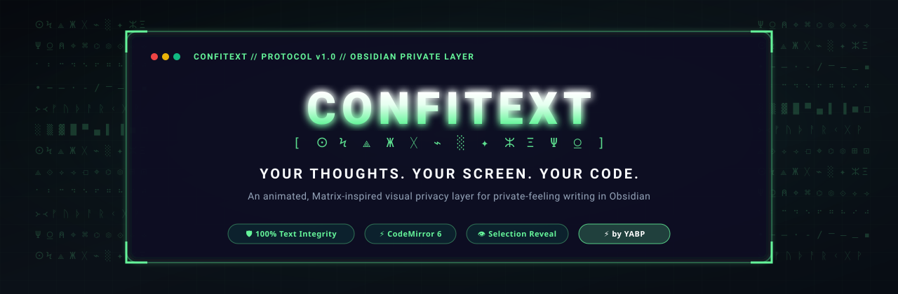
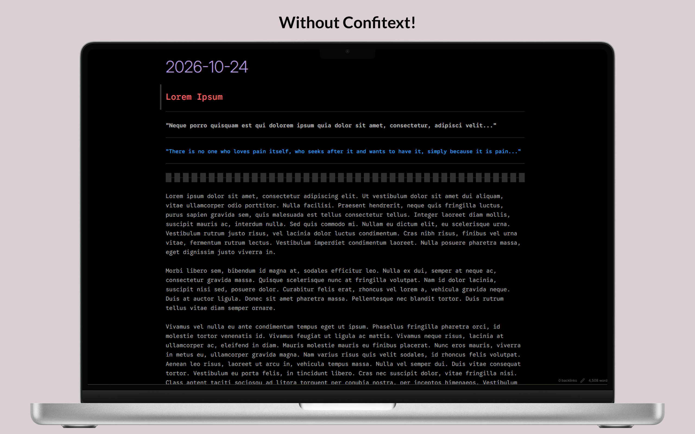
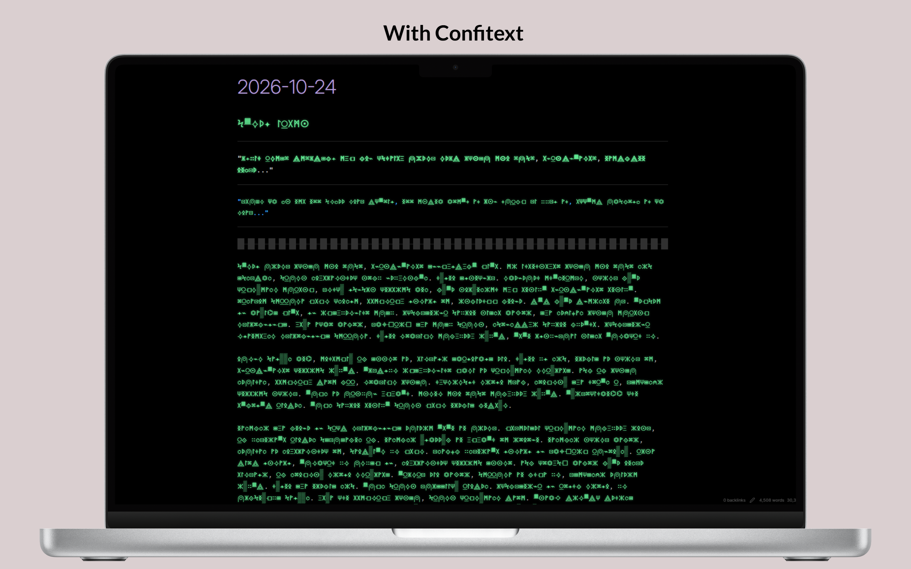
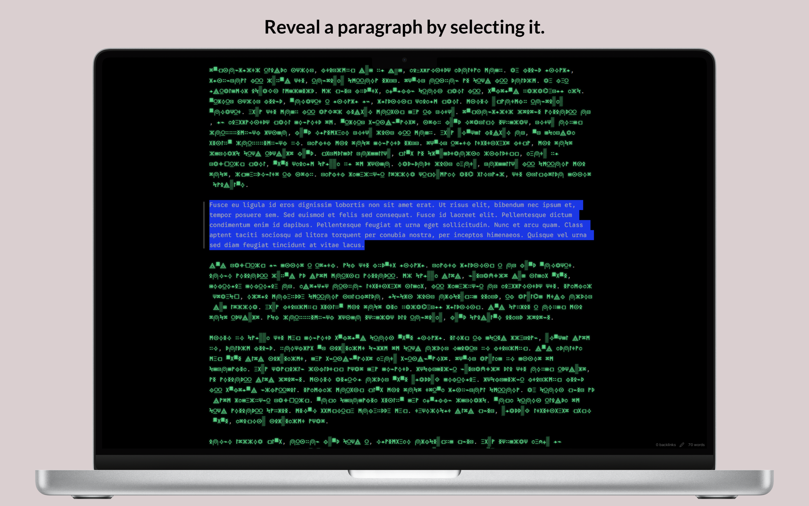
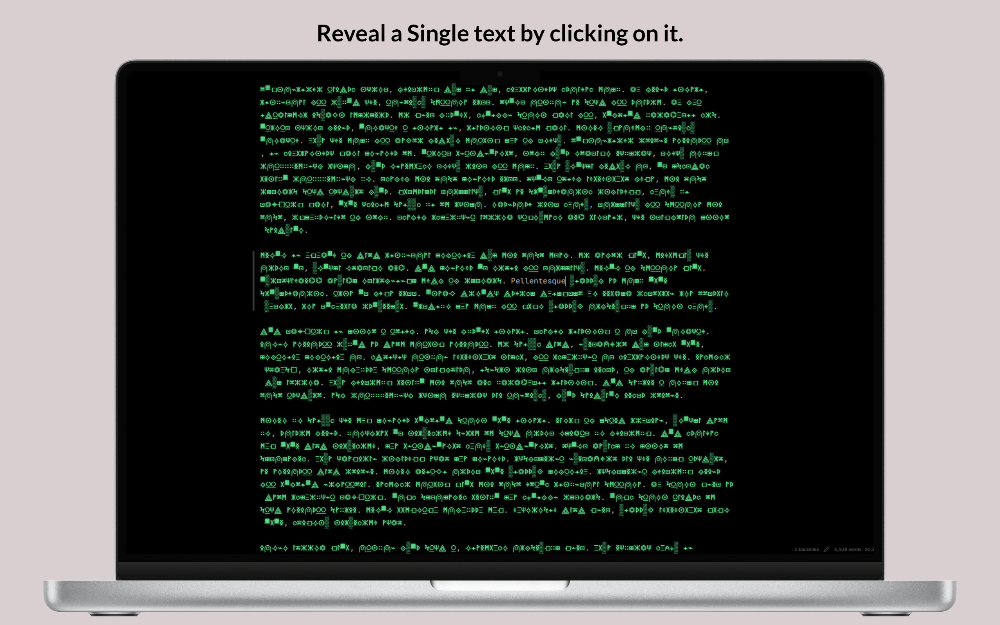

# Confitext

<p align="center">
  
</p>

<p align="center">
  <strong>Your thoughts. Your screen. Your code.</strong><br>
  <em>An animated, Matrix-inspired visual privacy layer for private writing in Obsidian.</em>
</p>

<p align="center">
  <a href="https://yabp.netlify.app/?verify=https://github.com/dheeraz101/Confitext">
    
  </a>
</p>

<p align="center">
  <a href="https://github.com/dheeraz101/Confitext/releases"></a>
  <a href="https://obsidian.md"></a>
  <a href="https://github.com/dheeraz101/Confitext/actions"></a>
  <a href="LICENSE"></a>
  <a href="https://yabp.netlify.app/"></a>
</p>

---

## Overview

Confitext transforms completed words into visual digital glyphs the moment you finish typing them. Whether you write in open offices, flights, cafes, or classrooms, Confitext protects your screen from wandering eyes without getting in the way of your thinking.

Your underlying notes remain completely untouched. Confitext uses non-destructive CodeMirror 6 replacement decorations. Highlight any text with your mouse or keyboard, and the words reveal themselves instantly for reading and editing.

```markdown
Underlying Markdown:
I will build something extraordinary today.

On-Screen Presentation:
ⵙϞ ⟁Ξᚷ ⌁Жⵙ ░ⵣϞ⟁ᚷ ⌁Ϟᚷⵙ

When you highlight "extraordinary":
ⵙϞ ⟁Ξᚷ ⌁Жⵙ extraordinary ⌁Ϟᚷⵙ
```

---

## Visual Showcase

### Before & After: Real-Time Shoulder-Surfing Deterrent

<p align="center">
  
  &nbsp;
  
</p>

<p align="center">
  <em>Left: Plain text exposed to wandering eyes. Right: Real-time visual masking protects your notes on screen.</em>
</p>

### Non-Destructive In-Place Reveal

<p align="center">
  
  &nbsp;
  
</p>

<p align="center">
  <em>Left: Drag over text or select paragraphs with keyboard to reveal and edit in-place. Right: Click any masked word in Reading View to toggle reveal.</em>
</p>

---

## Design Highlights

- **Targeted Word & Phrase Masking:** Mask specific sensitive words or phrases globally across all notes or locally via YAML frontmatter (`confitext-masked-words: [...]`), with right-click context menu integration.
- **Granular Hide Triggers:** Choose your typing privacy rhythm: **Word** (masks on space/punctuation), **Line** (keeps line visible until moving to another line), or **Paragraph** (keeps paragraph block visible until a full blank line gap is formed).
- **Sensitive Data Shield:** Automated real-time pattern shielding for emails, API keys/tokens, credit cards, phone numbers, IP addresses, plus custom regex.
- **Apple HIG Settings Architecture:** A reimagined settings panel inspired by macOS Sequoia featuring frosted glass cards, Dynamic Island pulse indicators, segmented controls, and an interactive macOS Terminal Sandbox.
- **Fluid Typing Flow:** Words remain readable while you type them. Completing a trigger boundary initiates a smooth scramble animation.
- **Zero Note Modification:** Confitext never replaces characters inside your Markdown files. Notes remain standard plain text at all times.
- **Live Matrix Sandbox:** An interactive playground built directly into Settings. Test animations, try different glyph sets, and feel selection reveal in real time.
- **Per-Note Exclusions:** Disable masking for public notes by adding `confitext: false` to the YAML frontmatter.
- **Per-Folder Exclusions:** Set designated directories (such as `Public/` or `Shared/`) where notes always remain visible.
- **Custom Glyph Importer:** Supply any Unicode symbols (Braille, Morse code, Runes, Tengwar, Klingon) with automated validation and deduplication.
- **Idle Auto-Masking:** Automatically switches to Masking mode when you leave your desk or switch applications.
- **Instant Selection Reveal:** Drag over text, double-click words, or navigate with Shift and Arrow keys to read words immediately.
- **Deterministic Glyph Stability:** Words consistently map to identical glyph patterns of matching length, avoiding layout shifts or line jumps.
- **Markdown Preservation:** Headings, lists, checkboxes, blockquotes, code blocks, inline code, math formulas, links, and footnotes remain readable.
- **Themes and Contrast:** Calibrated for dark and light Obsidian themes, with Matrix Green, Theme Accent, Monochrome, or custom colors.
- **Native Context Menus:** Right-click any note, folder, or editor selection to instantly toggle privacy, exclude folders, or reveal text.
- **Tab Header Privacy Shield:** A dedicated shield action button on every note tab header for instant one-click privacy status and mode toggling.
- **Reading View Post-Processor:** Extends visual masking to Obsidian Reading View (Preview Mode) with click-to-reveal word interactions.
- **Panic Mode:** Emergency quick-hide command (Confitext: Panic: Instant hide & mask all text) that deselects text and masks the screen immediately.

---

## Privacy Scope

> [!WARNING]
> Confitext is a visual shoulder-surfing deterrent. It changes how characters look on screen inside Obsidian. It does not encrypt your notes or protect files on disk.
>
> Anyone with access to your file system, cloud backups, or developer tools can read your files. Use dedicated disk encryption tools if you require cryptographic security.

---

## Managing Public Notes and Folders

### Exclude Individual Notes
Keep public notes readable by adding this frontmatter tag:

```markdown
---
title: Public Talk
confitext: false
---

This note stays readable and unmasked at all times.
```

*Tip: Press <kbd>Ctrl/Cmd + P</kbd> and run `Confitext: Toggle frontmatter exclusion for active note` to toggle this setting instantly.*

### Exclude Entire Folders
Open **Settings > Confitext > Per-Note & Per-Folder Masking Rules** and list folder paths (one per line, e.g. `Public`, `Shared/Team`). Notes in those folders bypass masking automatically.

---

## Custom Glyph Sets and Presets

Choose from built-in character sets or create your own:

1. Open **Settings > Confitext > Appearance & Glyph Styles**.
2. Select **Custom Glyph Set (User-Defined)**.
3. Paste symbols into the text box, or pick a preset:
   - **Braille Script:** `⠁⠃⠉⠙⠑⠋⠛⠓⠊⠚...`
   - **Morse Code:** `• − – · - / ⎻ ⎼ ⎽ ▪ ▫`
   - **Cyber Runes:** `᚛᚜ᚠᚢᚦᚨᚱᚲᚷᚹᚺᚻ...`
   - **Abstract Geometry:** `⟁⟐⟡⟢⟤⌖⌬⏣⊞⊡∷◈◇◆...`
   - **Matrix Code:** `ⵙϞ⟁Жᚷ⌁░✦ⵣΞΨ⍜⍝⌖⌘⌬...`
   - **Elvish / Tengwar:** `ñðþȝƿᵹɼſᶄᶅ`
   - **Klingon / Alien:** ``
   - **Alchemical & Celestial:** `🜂🜄🜁🜃🜔🜖🜍🝆☉☽☿♀♂...`
4. The validator strips whitespace, removes invalid surrogate pairs, and ensures at least two unique glyphs exist.

---

## Inactivity and Focus Protection

- **Inactivity Timer:** Pick a timeout between 1 and 60 minutes. If no typing, scrolling, or mouse motion occurs, Confitext switches to Masking mode automatically.
- **Window Blur Protection:** Turn on this toggle to mask text immediately whenever Obsidian loses focus (e.g. when Alt-Tabbing or switching apps).

---

## Installation

### Method 1: Obsidian Community Directory
1. Open Obsidian **Settings > Community plugins**.
2. Turn off **Restricted mode** to allow community plugins.
3. Select **Browse** and search for `Confitext`.
4. Select **Install**, then **Enable**.

### Method 2: Via BRAT (Beta Reviewers Auto-update Tester)
1. Install [BRAT](https://github.com/TfTHacker/obsidian-42-brat) from Community Plugins.
2. Open BRAT settings and select **Add Beta plugin**.
3. Enter `https://github.com/dheeraz101/Confitext`.
4. Confitext installs immediately and updates automatically with every release.

### Method 3: Manual Installation
1. Download `Confitext-Obsidian-Plugin.zip` from [Releases](https://github.com/dheeraz101/Confitext/releases).
2. Open your Obsidian vault in your file manager.
3. Open `.obsidian/plugins/` (show hidden files if needed).
4. Create a folder named `confitext`.
5. Extract `main.js`, `manifest.json`, and `styles.css` into that folder.
6. In Obsidian, open **Settings > Community plugins**, click **Reload plugins**, and turn on **Confitext**.

---

## Commands

Run these commands anytime from the Command Palette (<kbd>Ctrl/Cmd + P</kbd>):

| Command | Description |
| :--- | :--- |
| **Confitext: Toggle masking** | Switch between active visual masking and readable text. |
| **Confitext: Reveal all text** | Reveal all text across the active document. |
| **Confitext: Hide all text** | Mask all completed words in the active document. |
| **Confitext: Pause masking** | Temporarily suspend masking without changing settings. |
| **Confitext: Resume masking** | Resume visual masking after a pause. |
| **Confitext: Toggle animation** | Toggle the word scramble animation on or off. |
| **Confitext: Toggle idle auto-masking timer** | Enable or disable the inactivity timer. |
| **Confitext: Toggle frontmatter exclusion for active note** | Add or remove `confitext: false` from the active note frontmatter. |
| **Confitext: Open settings** | Open the Confitext configuration tab. |

---

## Settings Reference

### Live Matrix Sandbox
- **Interactive Preview:** Test scramble transitions and selection reveal live inside Settings.
- **Custom Input:** Type test phrases to preview how glyphs look before returning to your notes.

### Behavior
- **Enable Confitext:** Master switch for the masking layer.
- **Default Mode:** Initial state when opening notes (Masking, Revealed, or Paused).
- **Mask Newly Completed Words:** Automatically mask words as soon as you type Space.
- **Reveal Selected Text:** Reveal masked words under mouse or keyboard selections.
- **Reveal Entire Word on Selection:** Revealing any part of a word exposes the whole word.
- **Reveal on Cursor Inside Word:** Placing the caret inside a word reveals it for easy editing.

### Appearance and Styles
- **Glyph Style:** Pick Matrix Code, Cyber Runes, Geometry, Blocks, Braille, Morse, or Custom.
- **Mask Color Theme:** Matrix Green, Theme Accent, Monochrome, or Custom Hex.
- **Subtle Glow Effect:** Adds a soft phosphor glow to glyphs.
- **Mask Opacity:** Adjust glyph visibility between 40% and 100%.

### Animation
- **Enable Scramble Animation:** Animate words transitioning into glyphs.
- **Animation Speed:** Choose Fast (180ms), Standard (280ms), or Cinematic (420ms).
- **Respect Reduced Motion:** Honors system reduced-motion settings automatically.

### Idle and Auto-Masking
- **Enable Idle Auto-Masking:** Masks text after a set period of inactivity.
- **Idle Timeout:** Choose from 1 to 60 minutes.
- **Auto-Mask on Window Blur:** Masks notes when Obsidian loses focus.

### Note and Folder Rules
- **Respect Frontmatter Exclusion:** Honors `confitext: false`.
- **Excluded Folder Paths:** List folders that should always bypass masking.

---

## Contributing and Architecture

Confitext is written in TypeScript using standard CodeMirror 6 APIs.

```bash
# Clone the repository
git clone https://github.com/dheeraz101/Confitext.git
cd Confitext
npm install

# Live development watch mode
npm run dev

# Run TypeScript compiler checks
npm run typecheck

# Run automated Vitest test suite (105 tests)
npm test

# Build production bundle and packages
npm run package
```

Read [docs/ARCHITECTURE.md](docs/ARCHITECTURE.md) and [docs/TESTING.md](docs/TESTING.md) for deeper technical guidelines.

---

## YABP Initiative

<p align="center">
  <a href="https://yabp.netlify.app/?verify=https://github.com/dheeraz101/Confitext">
    
  </a>
</p>

Confitext is an official project of the **YABP (Yet Another Boring Project)** initiative.

- **Initiative Repository:** [Yet-Another-Boring-Project on GitHub](https://github.com/dheeraz101/Yet-Another-Boring-Project)
- **Official Website:** [yabp.netlify.app](https://yabp.netlify.app/)
- **License:** [MIT License](LICENSE) (c) 2026 Dheeraz.
